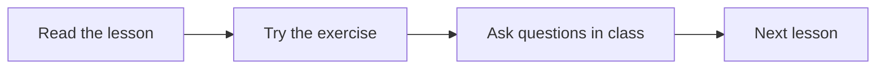

This first lesson sets out what we'll cover and how the course is organised.

## Learning goals

By the end of this lesson you can:

- explain what the course is about and how it is assessed
- find your way around these notes
- set up the tools listed in [[Useful links]]

## How the course is organised

Each week has one lesson page with theory, examples and a short exercise. Terms in the [[Glossary]] are linked the first time they appear, for example [[Glossary#Knowledge base|knowledge base]].

> [!important] Deadlines
> Exercises are due **before the next lesson** starts.

## Exercise

> [!question] Exercise 1
> Write down three things you hope to learn in this course.

> [!success]- Show a sample answer
> There's no single right answer here. This collapsible callout is just a handy way to hide solutions until students want them.

Next: [[02 Working with Markdown|Lesson 2: Working with Markdown]] →
